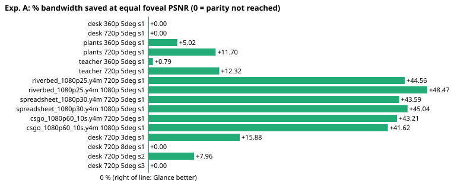
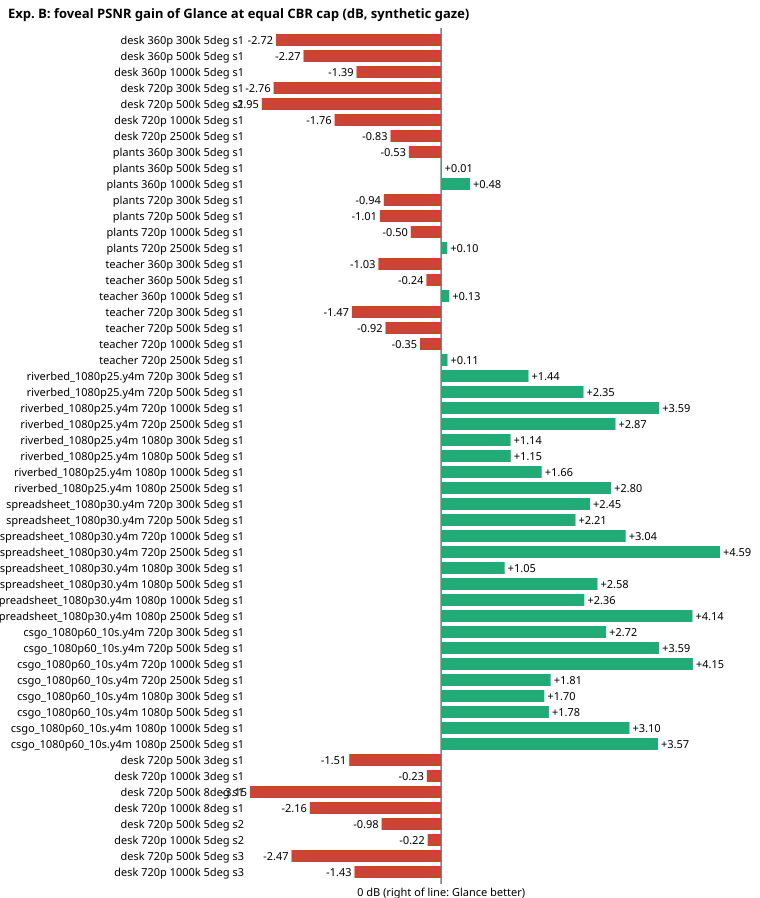
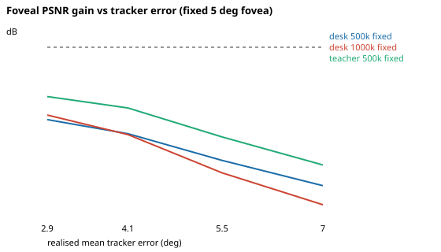
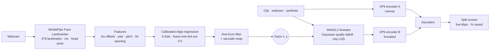

<div align="center">

# Glance

**Gaze-contingent video compression for video calls: track where the viewer looks, spend bits there,<br>and measure honestly whether it beats a normal encoder.**


[What it does](#what-it-does) · [Results](#results) · [How it works](#how-it-works) · [Run it](#run-it) · [Keys](#keys) · [Experiments](#experiments) · [Limits](#limits-and-what-is-not-measured)

</div>

## What it does

The eye only sees sharply in a small patch (the fovea, about 5° across). Everything outside it can be
coarser without the viewer noticing. Glance puts that to work on a video call:

1. **Tracks the gaze** from an ordinary webcam, in the browser, with no gaze hardware.
2. **Foveates the video** so it is sharp where you look and progressively blurred elsewhere.
3. **Encodes two streams** from the same frames (normal and foveated), decodes both, and shows them
   side by side with live bitrate and percent saved.
4. **Tests whether the idea holds up** in an offline harness that scores quality where the viewer
   actually looks, against an untouched baseline, with the baseline given exactly the same encoder
   settings.

The second half is the point of the repo. Most "attention-aware compression" demos stop at a
before/after image. This one reports the cases where it **loses**.

## Results

Foveal PSNR is measured in a disc around the true gaze point. All gaze traces are **synthetic**
(seeded generators), clips are the ones in `web/public/clips/`, and every comparison uses identical
encoder flags for both streams.

| Method | Video-call clips, equal bitrate | Busy, screen and game clips, equal bitrate | Bitrate saved at equal foveal quality |
|---|---|---|---|
| **Per-block quality** (H.264, x264 ROI) | **+2.72 to +3.46 dB, wins 9 of 9** | −0.28 to +4.40 dB, wins 8 of 9 | **46.5 to 62.0 %** on all six clips |
| **Blur pre-filter** (VP9, what the browser demo does) | −3.15 to +0.48 dB, wins 5 of 29 (mean −1.14 dB) | +1.05 to +4.59 dB, wins 24 of 24 | 0.8 to 15.9 % on calls (6 of 10), 41.6 to 48.5 % on busy content |
| **Two-layer grid** (VP9 low-res base plus a sharp crop) | −5.36 to −3.32 dB, wins 0 of 9 | +0.57 to +2.78 dB, wins 9 of 9 | not reached on calls, 14.6 to 27.5 % elsewhere |

<p align="center">
  
  
</p>

**What this says**

- Only **per-block quality** wins on video calls, by about **+3 dB** where the viewer looks, or about
  **half the bitrate** at the same foveal quality. It needs a native encoder: no shipped browser API
  exposes per-region quality (`docs/research.md` §8).
- The **blur pre-filter** the browser demo uses is bit-exact inside the fovea before encoding, but it
  **loses on talking heads** once the encoder's rate control sees a moving fovea. It wins on busy
  content, and the skeptic audit below says how much of that is real.
- **Tracker error is fatal for blur.** With simulated lag and error it lost in all 21 tracker-error
  conditions (mean −6.17 dB at 100 ms lag); 100 ms of lag alone gives about 2.9° of realised error
  on a saccade.

<p align="center"></p>

### The skeptic audit

`offline/experiments/skeptic.py --all` attacks the results instead of confirming them
(`results/raw/skeptic.json`):

- **Measurement and baseline are fair.** An independent scorer agrees within 0.005 dB, and both
  streams use the identical encoder command.
- **Busy-content gains are partly dropped frames.** At ≤1000 kbps the baseline drops 50 to 86 of 90
  frames. Counting only frames both streams encoded, the river gain falls from +3.59 to +0.23 dB and
  the spreadsheet gain from +3.04 to +0.61 dB. At 4000 kbps, with almost no drops, the gain is real
  (+2.77 and +4.61 dB).
- **Blur's call-clip loss comes from a jumpy trace.** With a fixed or calm call-like gaze it wins by
  about 1 dB; with a trace that jumps every 0.2 to 0.6 s it loses everywhere.
- **Scoring just outside the fovea is unforgiving.** Over a disc 1.5× the fovea radius, blur loses
  even with a fixed gaze (+1.08 to −2.87 dB).
- **A real bug was found and fixed:** on ffmpeg 8 the pre-filter corrupted tagged mp4 clips. There is
  now a regression test.

Full numbers: [`docs/results_experiments.md`](docs/results_experiments.md) (generated from
`results/raw/*.json`) and [`project_status.md`](project_status.md).

## How it works



| Part | Where | What it does |
|---|---|---|
| Gaze features | `web/src/gaze/features.ts` | Pure maths: iris offsets in eye widths per eye, head pose from the transform matrix, eyelid opening |
| Calibration | `gaze/regression.ts`, `gaze/calib.ts` | 9 dots, corners first, 300 ms drop then 1 s sample, per-dot median; ridge regression with λ chosen by leave-one-dot-out CV, which also gives the error σ. At least 7 dots needed, 30 s cap |
| Filter | `gaze/filter.ts` | One-Euro on x and y with speed-based cutoff, plus a saccade snap that needs a second nearby sample so an unconfirmed outlier is held |
| Validation | `gaze/accuracy.ts`, `gaze/validate.ts` | 20 seeded dots; error in degrees of visual angle (`atan(err / pxPerCm / distance)`); **≤2.5° GO, ≤4° GO with a bigger fovea, else PIVOT** |
| Foveation | `video/fovea.ts`, `video/foveate.ts` | Radius is `hypot(5° in px, 2σ)`, so a noisier tracker widens the sharp region; WebGL2 with texture mips and 5 taps |
| Encoding | `video/encoders.ts`, `video/rate.ts` | Two VP9 `vp09.00.31.08` realtime encoders, same QP, keyframe every 2 s, frame pairs dropped together; CBR 500 kbps for bad-network mode |
| Display | `video/decoder.ts`, `ui/split.ts`, `metrics/` | Both streams decoded side by side; per-second kbps, percent saved, live foveal PSNR and SSIM |
| Offline harness | `offline/experiments/` | Pure Python and ffmpeg: traces, ROI and layered encoders, transport loss, report generator, skeptic |

## Run it

Node 22+ and Chrome (WebCodecs and WebGL2).

```text
cd web
npm ci
npm run dev        # http://localhost:5173
```

Add `?screencm=<width of your screen in cm>`: browsers cannot know physical size, and the degree
conversion depends on it (also `&dist=<cm>`, default 60). Allow the webcam when asked.

Everything runs on-device. The MediaPipe models and WASM are served locally, and the smoke test
asserts **zero external requests**.

**Quick path:** press **C** and follow the 9 dots, **T** to validate (read the verdict in degrees),
**1-3** to pick a clip, **E** then **S** for the split screen, **R** to see where the bits go.

## Keys

| Key | Action |
|---|---|
| `M` | Toggle mouse or eyes as the gaze source (falls back to the mouse after 500 ms without a face) |
| `C` | Calibrate (Esc cancels) · `X` recenter · `T` validate accuracy |
| `V` | Camera view with landmarks, eye corners and iris circles |
| `1`-`9` | Pick a source: clips, then webcam |
| `F` | Preview the foveation on the main view |
| `E` | Start the two encoders · `S` split screen with live kbps and percent saved |
| `R` | Reveal: tint the quality map (red sharp, blue coarse); drawn on the viewer only, never encoded |
| `B` | Bad-network mode: both encoders at 500 kbps CBR |
| `G` | Record the gaze trace; a second press downloads JSON |

## Experiments

```text
python offline/experiments/run.py --quick      # smoke run
python offline/experiments/run.py --ab         # equal-quality bisection and equal-cap comparison
python offline/experiments/run.py --t8         # transport loss and tracker error
python offline/experiments/roi.py --out        # per-block (x264 ROI) method
python offline/experiments/layers.py --out     # two-layer grid method
python offline/experiments/skeptic.py --all    # attack the results
python offline/experiments/run.py --report     # rebuild docs/results_experiments.md and charts
python -m unittest discover -s offline/experiments -p "test_*.py"
```

Standard library and ffmpeg only. Luma PSNR and SSIM are computed in a disc around the true gaze
with masked ffmpeg filters. Transport is modelled as seeded 1200 B packet loss (2 %), a 100 ms
jitter buffer, and a freeze until the next keyframe with no retransmission, which is pessimistic.

```text
cd web && npm run smoke    # build, unit tests, then headless Chrome with a fake webcam
```

## Limits and what is not measured

- **Gaze traces are synthetic.** Real webcam traces are missing; `G` records one.
- **PSNR and SSIM only.** No VMAF or FovVideoVDP (not installed on the test host) and no user study.
- **Per-block and two-layer methods have no tracker error or lag** applied; blur lost in all 21
  such conditions.
- **The periphery pays.** Per-block quality costs −0.2 to −3.6 dB outside the fovea at equal
  bitrate, and −4.7 to −7.6 dB in the saving case.
- **x264 is not bit-deterministic**, so gains under about 0.5 dB are noise.
- **The browser demo shows the weakest method.** WebCodecs has no per-region QP, so the in-browser
  ~50 % smaller size at the same QP is not an equal-quality result and should not be quoted as
  bandwidth saving.
- **Clips** are three Mixkit video-call clips under the Mixkit free license (`web/public/clips/CREDITS.md`).

## Layout

```text
web/              Vite + TypeScript app: gaze/, video/, ui/, metrics/, smoke test
offline/          Python harness: experiments/ (methods, traces, transport, report, skeptic)
docs/             research, results, generated experiment report, course-correction notes
results/          raw JSON, generated charts
autopilot/        headless Claude Code task queue used to build and run experiments
```
