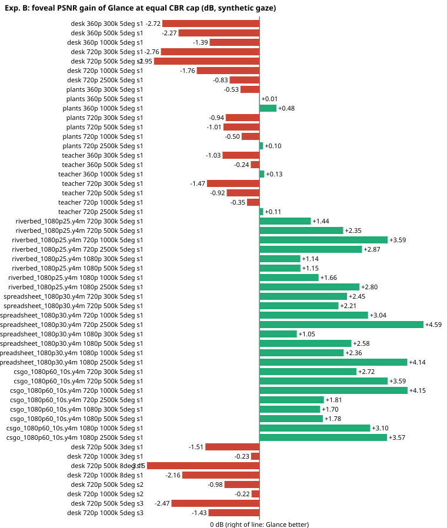

# Glance — experiment results (generated)

**Generated by `python3 offline/experiments/report.py` from `results/raw/*.json`; do not edit by hand.** The raw data come from `python3 offline/experiments/run.py --ab` (A, B) and `--t8` (transport, tracker error).

**All gaze traces are SYNTHETIC (seeded generator, `traces.py`), all content is the three real 'call' clips in `web/public/clips/` (talking heads, easy content). Codec: libvpx-vp9 realtime CBR, identical flags for baseline and Glance; they differ only in the input frames. Quality is measured with PSNR/SSIM inside a disc of the nominal fovea radius around the (true) gaze and compared with the untouched source. Not measured: FovVideoVDP skipped: pyfvvdp is not installed; VMAF skipped: this ffmpeg has no libvmaf filter. No real webcam tracking data is involved: tracker error is simulated (T8).**

## Claim 2: same bandwidth, better quality where it matters (Experiment B, equal CBR cap)

Reproduce: `python3 offline/experiments/run.py --ab && python3 offline/experiments/report.py`

**Result: the claim is NOT supported on this content.** 29 conditions: mean foveal-PSNR gain of Glance over baseline -1.15 dB, best +0.48 dB (call-plants 360p 1000 kbps, 5 deg), worst -3.17 dB (call-desk 720p 500 kbps, 8 deg). Glance is better in 5 of 29 conditions.

| Clip | Res | Cap kbps | Fovea deg | Seed | kbps base / Glance | Foveal PSNR base / Glance (dB) | gain dB | worst-frame foveal PSNR base / Glance | foveal SSIM base / Glance |
|---|---|---|---|---|---|---|---|---|---|
| call-desk | 360p | 300 | 5 | 1 | 298 / 299 | 43.92 / 41.19 | -2.73 | 36.4 / 35.7 | 0.984 / 0.974 |
| call-desk | 360p | 500 | 5 | 1 | 484 / 488 | 46.43 / 44.17 | -2.27 | 39.0 / 39.1 | 0.989 / 0.984 |
| call-desk | 360p | 1000 | 5 | 1 | 920 / 933 | 48.69 / 47.29 | -1.39 | 41.4 / 39.8 | 0.993 / 0.991 |
| call-desk | 720p | 300 | 5 | 1 | 319 / 320 | 40.96 / 38.21 | -2.75 | 35.2 / 30.2 | 0.966 / 0.948 |
| call-desk | 720p | 500 | 5 | 1 | 519 / 507 | 43.46 / 40.50 | -2.96 | 35.9 / 35.2 | 0.977 / 0.965 |
| call-desk | 720p | 1000 | 5 | 1 | 968 / 974 | 45.97 / 44.21 | -1.76 | 38.1 / 38.0 | 0.985 / 0.981 |
| call-desk | 720p | 2500 | 5 | 1 | 2296 / 2333 | 48.83 / 48.00 | -0.83 | 41.3 / 40.9 | 0.991 / 0.990 |
| call-plants | 360p | 300 | 5 | 1 | 293 / 299 | 38.00 / 37.46 | -0.54 | 30.5 / 30.9 | 0.963 / 0.959 |
| call-plants | 360p | 500 | 5 | 1 | 478 / 487 | 40.48 / 40.50 | +0.02 | 32.7 / 33.2 | 0.978 / 0.977 |
| call-plants | 360p | 1000 | 5 | 1 | 950 / 959 | 43.67 / 44.15 | +0.48 | 36.2 / 35.8 | 0.988 / 0.988 |
| call-plants | 720p | 300 | 5 | 1 | 329 / 327 | 36.06 / 35.12 | -0.94 | 21.8 / 25.7 | 0.937 / 0.929 |
| call-plants | 720p | 500 | 5 | 1 | 500 / 502 | 38.94 / 37.93 | -1.01 | 32.6 / 30.8 | 0.964 / 0.956 |
| call-plants | 720p | 1000 | 5 | 1 | 960 / 974 | 42.10 / 41.53 | -0.57 | 33.7 / 34.5 | 0.979 / 0.977 |
| call-plants | 720p | 2500 | 5 | 1 | 2392 / 2400 | 45.86 / 45.96 | +0.10 | 38.3 / 38.1 | 0.990 / 0.989 |
| call-teacher | 360p | 300 | 5 | 1 | 298 / 299 | 40.72 / 39.69 | -1.03 | 36.0 / 34.4 | 0.982 / 0.977 |
| call-teacher | 360p | 500 | 5 | 1 | 480 / 493 | 42.78 / 42.52 | -0.26 | 38.0 / 35.8 | 0.987 / 0.985 |
| call-teacher | 360p | 1000 | 5 | 1 | 943 / 934 | 45.60 / 45.74 | +0.13 | 38.9 / 36.6 | 0.992 / 0.991 |
| call-teacher | 720p | 300 | 5 | 1 | 314 / 324 | 39.02 / 37.52 | -1.50 | 35.2 / 31.4 | 0.967 / 0.956 |
| call-teacher | 720p | 500 | 5 | 1 | 494 / 498 | 40.92 / 39.79 | -1.13 | 35.8 / 34.1 | 0.975 / 0.968 |
| call-teacher | 720p | 1000 | 5 | 1 | 950 / 971 | 43.63 / 43.28 | -0.35 | 38.5 / 37.8 | 0.984 / 0.982 |
| call-teacher | 720p | 2500 | 5 | 1 | 2358 / 2391 | 47.06 / 47.16 | +0.11 | 40.3 / 39.1 | 0.991 / 0.990 |
| call-desk | 720p | 500 | 3 | 1 | 519 / 495 | 43.76 / 42.24 | -1.52 | 36.4 / 34.8 | 0.977 / 0.970 |
| call-desk | 720p | 1000 | 3 | 1 | 968 / 953 | 46.14 / 45.90 | -0.23 | 38.5 / 38.4 | 0.985 / 0.984 |
| call-desk | 720p | 500 | 8 | 1 | 519 / 516 | 42.92 / 39.75 | -3.17 | 35.5 / 35.5 | 0.977 / 0.964 |
| call-desk | 720p | 1000 | 8 | 1 | 968 / 976 | 45.68 / 43.51 | -2.16 | 38.1 / 38.1 | 0.986 / 0.981 |
| call-desk | 720p | 500 | 5 | 2 | 519 / 494 | 41.73 / 40.75 | -0.98 | 37.3 / 37.5 | 0.975 / 0.969 |
| call-desk | 720p | 1000 | 5 | 2 | 968 / 961 | 44.65 / 44.43 | -0.22 | 37.5 / 40.5 | 0.985 / 0.984 |
| call-desk | 720p | 500 | 5 | 3 | 519 / 510 | 43.41 / 40.94 | -2.46 | 34.9 / 34.3 | 0.977 / 0.966 |
| call-desk | 720p | 1000 | 5 | 3 | 968 / 999 | 46.25 / 44.82 | -1.43 | 37.5 / 37.4 | 0.986 / 0.982 |

## Claim 1: same quality, less bandwidth (Experiment A, bisection)

Reproduce: same command as above. For each condition the baseline is encoded at a target cap; the script then searches for the lowest Glance cap whose foveal PSNR is within 0.5 dB of the baseline's (`reached`); otherwise the row says not reached.

**Result: weak and not reliable.** Quality parity was reached in 6 of 10 conditions with savings of 1.5 to 15.9 % (mean 9.1 %, worst reached 1.5 %); NOT reached in 4 conditions (listed below; they are not averaged in).

| Clip | Res | Fovea deg | Seed | Baseline target kbps | Baseline kbps | Baseline foveal PSNR | Goal (>=) | Glance kbps | Saved % | Glance foveal PSNR |
|---|---|---|---|---|---|---|---|---|---|---|
| call-desk | 360p | 5 | 1 | 500 | 484 | 46.43 | 45.93 | not reached | - | - |
| call-desk | 720p | 5 | 1 | 2500 | 2296 | 48.83 | 48.33 | not reached | - | - |
| call-plants | 360p | 5 | 1 | 500 | 478 | 40.48 | 39.98 | 455 | 4.9 | 40.05 |
| call-plants | 720p | 5 | 1 | 2500 | 2392 | 45.86 | 45.36 | 2110 | 11.8 | 45.41 |
| call-teacher | 360p | 5 | 1 | 500 | 480 | 42.78 | 42.28 | 473 | 1.5 | 42.33 |
| call-teacher | 720p | 5 | 1 | 2500 | 2358 | 47.06 | 46.56 | 2067 | 12.3 | 46.59 |
| call-desk | 720p | 3 | 1 | 2500 | 2296 | 48.90 | 48.40 | 1931 | 15.9 | 48.48 |
| call-desk | 720p | 8 | 1 | 2500 | 2296 | 48.80 | 48.30 | not reached | - | - |
| call-desk | 720p | 5 | 2 | 2500 | 2296 | 48.05 | 47.55 | 2113 | 8.0 | 47.59 |
| call-desk | 720p | 5 | 3 | 2500 | 2296 | 49.21 | 48.71 | not reached | - | - |

## Where Glance loses: tracker error + 100 ms lag (T8, simulated)

Reproduce: `python3 offline/experiments/run.py --t8 && python3 offline/experiments/report.py` (~35 min). Fovea centre = true gaze 100 ms old plus AR(1) noise; quality scored at the TRUE gaze in a 5 deg disc; baseline at the same cap. 'adaptive' = fovea radius grows with the error.

| Clip | Cap kbps | Radius mode | Target error deg | Realised mean error deg | Foveal PSNR gain (dB) | Foveal SSIM gain | Full-frame PSNR gain (dB) |
|---|---|---|---|---|---|---|---|
| call-desk | 500 | fixed | 0 | 2.9 | -5.65 | -0.035 | -14.56 |
| call-desk | 500 | fixed | 2 | 4.1 | -6.76 | -0.041 | -14.64 |
| call-desk | 500 | adaptive | 2 | 4.1 | -5.94 | -0.034 | -13.41 |
| call-desk | 500 | fixed | 4 | 5.5 | -8.84 | -0.053 | -14.80 |
| call-desk | 500 | adaptive | 4 | 5.5 | -5.11 | -0.025 | -10.31 |
| call-desk | 500 | fixed | 6 | 7.0 | -10.81 | -0.071 | -14.96 |
| call-desk | 500 | adaptive | 6 | 7.0 | -3.85 | -0.015 | -6.50 |
| call-desk | 1000 | fixed | 0 | 2.9 | -5.29 | -0.029 | -17.35 |
| call-desk | 1000 | fixed | 2 | 4.1 | -6.82 | -0.032 | -17.42 |
| call-desk | 1000 | adaptive | 2 | 4.1 | -5.83 | -0.026 | -16.10 |
| call-desk | 1000 | fixed | 4 | 5.5 | -9.81 | -0.046 | -17.57 |
| call-desk | 1000 | adaptive | 4 | 5.5 | -4.92 | -0.019 | -12.70 |
| call-desk | 1000 | fixed | 6 | 7.0 | -12.30 | -0.065 | -17.74 |
| call-desk | 1000 | adaptive | 6 | 7.0 | -3.61 | -0.010 | -7.90 |
| call-teacher | 500 | fixed | 0 | 2.9 | -3.85 | -0.029 | -10.65 |
| call-teacher | 500 | fixed | 2 | 4.1 | -4.74 | -0.032 | -10.75 |
| call-teacher | 500 | adaptive | 2 | 4.1 | -4.05 | -0.024 | -8.80 |
| call-teacher | 500 | fixed | 4 | 5.5 | -7.01 | -0.045 | -11.06 |
| call-teacher | 500 | adaptive | 4 | 5.5 | -3.22 | -0.014 | -5.27 |
| call-teacher | 500 | fixed | 6 | 7.0 | -9.19 | -0.065 | -11.46 |
| call-teacher | 500 | adaptive | 6 | 7.0 | -2.04 | -0.007 | -2.63 |

Foveal PSNR gain over all 21 tracker-error conditions: mean -6.17 dB, best -2.04 dB, worst -12.30 dB; positive in 0 of 21.

## Loss and jitter (T8 transport model, 2 % packet loss, no retransmission)

This model is pessimistic: frames are frozen until the next keyframe, so most frames are frozen for BOTH streams and the comparison is dominated by freezes. Differences are inside the noise of 4 seeds; no claim is made.

| Clip | Cap kbps | Gain clean (dB) | Gain lossy (dB) | Frozen fraction base / Glance (lossy, mean) | Foveal PSNR lossy base / Glance (mean; worst seed) |
|---|---|---|---|---|---|
| call-desk | 500 | -2.60 | -0.80 | 0.80 / 0.81 | 33.28 (29.47) / 32.49 (31.31) |
| call-desk | 1000 | -1.55 | -3.21 | 0.92 / 0.86 | 32.62 (27.62) / 29.41 (25.73) |
| call-plants | 500 | -0.88 | +2.78 | 0.82 / 0.79 | 24.77 (21.82) / 27.55 (24.01) |
| call-plants | 1000 | -0.43 | -0.24 | 0.86 / 0.86 | 24.80 (22.56) / 24.56 (22.61) |
| call-teacher | 500 | -0.82 | +0.54 | 0.80 / 0.83 | 25.14 (21.42) / 25.69 (21.87) |
| call-teacher | 1000 | -0.09 | +0.84 | 0.82 / 0.85 | 24.18 (21.62) / 25.01 (22.14) |

## Headline numbers (synthetic gaze, call clips, VP9 CBR; VMAF not available)

| Content | Res | Network | Codec | Fovea | Baseline kbps | Glance kbps | % saved | Foveal PSNR base/Glance | Foveal VMAF base/Glance |
|---|---|---|---|---|---|---|---|---|---|
| call-desk | 720p | clean, Exp. A | VP9 | 3 deg | 2296 | 1931 | 15.9 | 48.90 / 48.48 | n/a |
| call-teacher | 720p | clean, Exp. A | VP9 | 5 deg | 2358 | 2067 | 12.3 | 47.06 / 46.59 | n/a |
| call-plants | 720p | clean, Exp. A | VP9 | 5 deg | 2392 | 2110 | 11.8 | 45.86 / 45.41 | n/a |
| call-plants | 360p | CBR 1000 kbps, Exp. B (best case) | VP9 | 5 deg | 950 | 959 | -1.0 | 43.67 / 44.15 | n/a |
| call-desk | 720p | CBR 500 kbps, Exp. B (worst case) | VP9 | 8 deg | 519 | 516 | 0.7 | 42.92 / 39.75 | n/a |

## Honest summary

- With the current pre-filter-only Glance (blur and downscale outside the fovea, then a standard VP9 encode), on easy talking-head clips and with synthetic gaze, the equal-quality saving is small or absent and the equal-bandwidth quality gain is mostly negative. This is what the data say; we do not claim the pitch numbers.
- Not tested yet: busy/screen/game content (Xiph downloads were refused in the unattended runs, task T7b), real webcam gaze traces, VMAF / FovVideoVDP, encoders with true per-region QP (not available in WebCodecs).
- The in-browser smoke test measures ~50 % fewer kbps at the same constant QP over 11 frame pairs; that is a same-QP size comparison (the foveal PSNR is similar) and is not the same as the CBR experiments above. Do not mix them.
